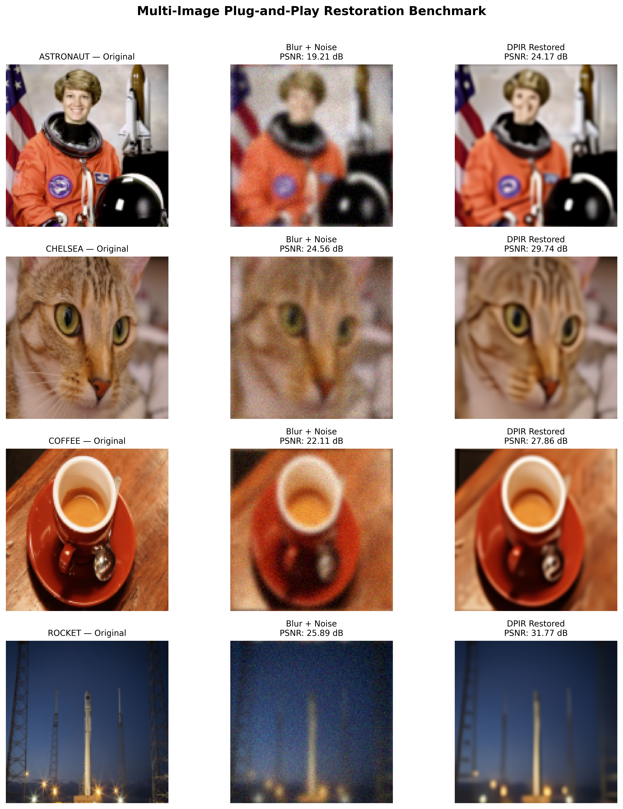

<div align="center">


# Plug-and-Play Image Restoration with Coarse-to-Fine Initialization

**A reproducible benchmark comparing direct, observation-initialized, and two-level DRUNet-based restoration pipelines using DeepInverse on Google Colab.**

[**Read the Full Report (PDF)**](docs/DeepInverse_PnP_Research_Report.pdf) · [**Open Notebook in Colab**](https://colab.research.google.com/github/Hasnain006-nain/deepinverse-pnp-image-restoration/blob/main/notebooks/DeepInverse_PnP_Image_Restoration.ipynb) · [**Browse Results (CSV)**](results/)

---

[](https://python.org)
[](https://pytorch.org)
[](https://deepinv.github.io/deepinv/)
[](LICENSE)

</div>

---

## What this project is (and is not)

This repository documents a controlled experimental comparison of three initialization strategies for Plug-and-Play (PnP) image restoration using a pretrained DRUNet denoiser. Four standard test images were degraded with synthetic Gaussian blur and noise, then reconstructed 60 times across five random seeds and three pipelines. All code, data, and figures are included for independent verification.

This is an exploratory benchmark built on existing open-source tools. It is not a novel algorithm, not a convergence proof, and not a flow-matching implementation.

---

## The question we tested

Standard PnP-DPIR starts iterating from the raw degraded observation. We asked: does it help to first solve a cheaper, downscaled version of the problem and use that estimate as a warm start for the full-resolution solver?

We compared three approaches on every image-seed pair:

| Pipeline | What it does | Avg. runtime |
|:--|:--|:--:|
| **Direct DPIR** | Standard HQS-DPIR initialized from the observation | 0.272 s |
| **Observation init** | Downsample observation to 64×64, upsample back, use as init (no coarse denoising) | 0.274 s |
| **Coarse PnP init** | Solve 64×64 PnP-DPIR first, upsample the result, use as init for 128×128 | 0.377 s |

The second pipeline isolates the effect of low-pass filtering from the effect of coarse-scale denoising.

---

## Results at a glance

### Overall performance (60 runs, Tesla T4 GPU)

| Pipeline | Mean PSNR | Mean SSIM | Avg. runtime |
|:--|:--:|:--:|:--:|
| Direct DPIR | 28.411 dB | 0.8588 | 0.272 s |
| Observation init | 28.530 dB | 0.8603 | 0.274 s |
| **Coarse PnP init** | **28.593 dB** | **0.8622** | 0.377 s |

### Paired differences (same image, same noise seed)

| Comparison | Mean PSNR gain | Positive in _n_ / 20 trials |
|:--|:--:|:--:|
| Coarse PnP vs Direct | +0.182 dB | 20 / 20 |
| Observation init vs Direct | +0.118 dB | 20 / 20 |
| Coarse PnP vs Observation init | +0.064 dB | 20 / 20 |

The coarse PnP approach wins every single paired comparison, but the margin is small and the extra stage costs roughly 39% more wall-clock time.

### Where it helps, where it doesn't

| Image | Coarse vs Direct | Coarse vs Obs init | Notes |
|:--|:--:|:--:|:--|
| Coffee | +0.397 dB | +0.112 dB | Smooth gradients, broad tonal areas |
| Astronaut | +0.287 dB | +0.112 dB | Mixed structure, face and suit |
| Rocket | +0.029 dB | +0.024 dB | High-contrast sharp edges |
| Chelsea | +0.015 dB | +0.007 dB | Fine fur texture, high frequency |

Images with smoother content gain more. Fine-textured images see almost no benefit because the 64×64 downsampling throws away exactly the high-frequency information those images need.

---

## Figures

### Degradation model

<p align="center">

</p>

Gaussian blur (kernel size 7×7, sigma 2.0) followed by additive Gaussian noise (sigma 0.03). The frequency spectrum shows the expected high-frequency roll-off.

---

### TV-PGD vs learned DPIR

<p align="center">

</p>

Classical Total Variation restoration produces piecewise-constant artifacts. DRUNet-based DPIR recovers finer texture detail and gains +1.9 to +2.7 dB over TV-PGD, while running 7× faster.

| Image | Degraded | TV-PGD | DPIR | DPIR gain over TV |
|:--|:--:|:--:|:--:|:--:|
| Astronaut | 19.18 dB | 22.23 dB | 24.13 dB | +1.90 dB |
| Chelsea | 24.57 dB | 27.22 dB | 29.74 dB | +2.52 dB |
| Coffee | 22.12 dB | 25.95 dB | 27.84 dB | +1.89 dB |
| Rocket | 25.92 dB | 29.15 dB | 31.81 dB | +2.66 dB |

---

### Multi-level restoration stages

<p align="center">

</p>

The coarse 64×64 solution is visibly soft but captures overall structure. After bicubic upsampling and a second DPIR pass at full resolution, the final output sharpens substantially.

---

### Initialization ablation across seeds

<p align="center">

</p>

Each bar group shows a single seed. Coarse PnP init (green) is consistently above direct DPIR (blue) and observation init (orange) for Coffee and Astronaut. For Chelsea and Rocket, the three bars are nearly identical.

---

### Noise robustness

<p align="center">
<br>

</p>

PSNR decreases monotonically as noise sigma increases from 0.01 to 0.07. The learned prior gracefully degrades without introducing visible ringing.

---

### Convergence behavior

<p align="center">


</p>

Left: PSNR climbs rapidly in the first 3–4 HQS iterations, then flattens. Right: the relative residual drops below 0.01 within 5 iterations.

---

### Full four-image overview

<p align="center">

</p>

---

## Limitations

These are worth stating plainly:

- **Only four test images.** Five noise seeds per image help with noise variability, but the image sample itself is small. Conclusions about "which textures benefit" are observations on these four pictures, not population-level claims.
- **Runtime cost.** The coarse stage adds ~39% overhead. For a 0.18 dB average gain, many applications would not make that trade.
- **Approximate coarse operator.** The 64×64 blur kernel was obtained by resizing the fine kernel, not by mathematically deriving a restriction operator. A proper multigrid formulation would require consistent restriction/prolongation.
- **No flow-matching.** This study uses standard DRUNet DPIR. It does not implement flow-matching models, score-based diffusion, or any generative restoration approach.
- **Not independently rerun.** The recorded metrics were validated from the original Colab session. A clean-runtime rerun is recommended before drawing firm conclusions.

---

## Reproduction

### Google Colab (recommended)

Click the badge to open the notebook with free GPU:

[](https://colab.research.google.com/github/Hasnain006-nain/deepinverse-pnp-image-restoration/blob/main/notebooks/DeepInverse_PnP_Image_Restoration.ipynb)

Select a T4 GPU runtime and run cells top-to-bottom.

### Local setup

```bash
git clone https://github.com/Hasnain006-nain/deepinverse-pnp-image-restoration.git
cd deepinverse-pnp-image-restoration
pip install -r requirements.txt
```

### Regenerate the PDF report

```bash
pip install reportlab
python scripts/generate_pdf_report.py
```

### Recorded environment

| Package | Version |
|:--|:--|
| Python | 3.13.16 |
| PyTorch | 2.11.0+cu130 |
| DeepInverse | 0.5.0 |
| NumPy | 2.1.3 |
| Matplotlib | 3.10.0 |
| scikit-image | 0.25.2 |
| GPU | NVIDIA Tesla T4 |

---

## Repository layout

```
deepinverse-pnp-image-restoration/
├── README.md
├── LICENSE                              (MIT)
├── requirements.txt
├── environment.json                     (pinned versions)
├── SHA256SUMS.txt                       (file integrity checksums)
│
├── notebooks/
│   └── DeepInverse_PnP_Image_Restoration.ipynb
│
├── results/                             (13 CSV files, raw numerical data)
│   ├── step10_all_experiments.csv       (all 60 runs)
│   ├── step10_paired_comparison.csv     (paired deltas)
│   ├── step11_method_summary.csv        (aggregate per method)
│   ├── step11_image_summary.csv         (aggregate per image)
│   ├── step7_tv_vs_dpir_results.csv     (TV vs DPIR baseline)
│   ├── step8_convergence_metrics.csv    (iteration-level traces)
│   └── ...
│
├── figures/                             (10 PNG research figures)
│   ├── step10_initialization_ablation.png
│   ├── step7_method_comparison.png
│   ├── step9_multilevel_comparison.png
│   └── ...
│
├── docs/
│   ├── DeepInverse_PnP_Research_Report.pdf
│   └── RESEARCH_SUMMARY.md
│
└── scripts/
    └── generate_pdf_report.py
```

---

## References

1. J. Tachella et al., "DeepInverse: a Python package for solving imaging inverse problems with deep learning," arXiv:2505.20160, 2025. [[arXiv]](https://arxiv.org/abs/2505.20160)

2. K. Zhang, Y. Li, W. Zuo, L. Zhang, L. Van Gool, R. Timofte, "Plug-and-Play Image Restoration with Deep Denoiser Prior," IEEE TPAMI, vol. 44, no. 10, pp. 6360–6376, 2022. [[DOI]](https://doi.org/10.1109/TPAMI.2021.3088914)

3. S. V. Venkatakrishnan, C. A. Bouman, B. Wohlberg, "Plug-and-Play Priors for Model Based Reconstruction," IEEE GlobalSIP, pp. 945–948, 2013. [[DOI]](https://doi.org/10.1109/GlobalSIP.2013.6737048)

4. S. Martin, A. Gagneux, P. Hagemann, G. Steidl, "Plug-and-Play Image Restoration with Flow Matching," ICLR, 2025. [[OpenReview]](https://openreview.net/forum?id=V2c2YxK0eG)

---

## License

MIT — see [LICENSE](LICENSE).

## Author

**Hasnain Haider** — [GitHub](https://github.com/Hasnain006-nain)

---

<div align="center">
<sub>Built with <a href="https://github.com/deepinv/deepinv">DeepInverse</a> and pretrained DRUNet. All experiments run on Google Colab with free T4 GPU.</sub>
</div>
