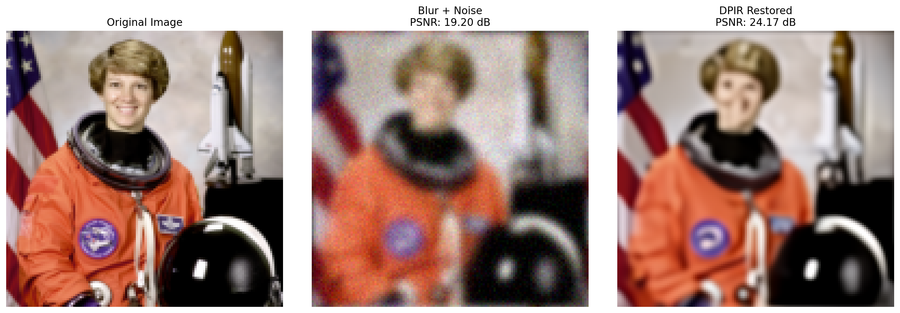
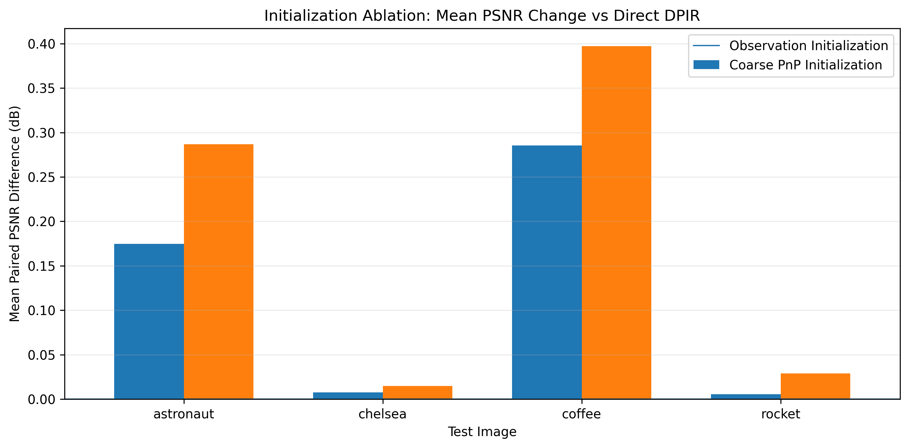
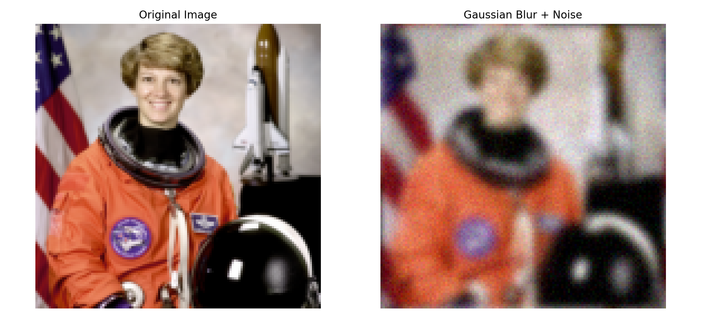
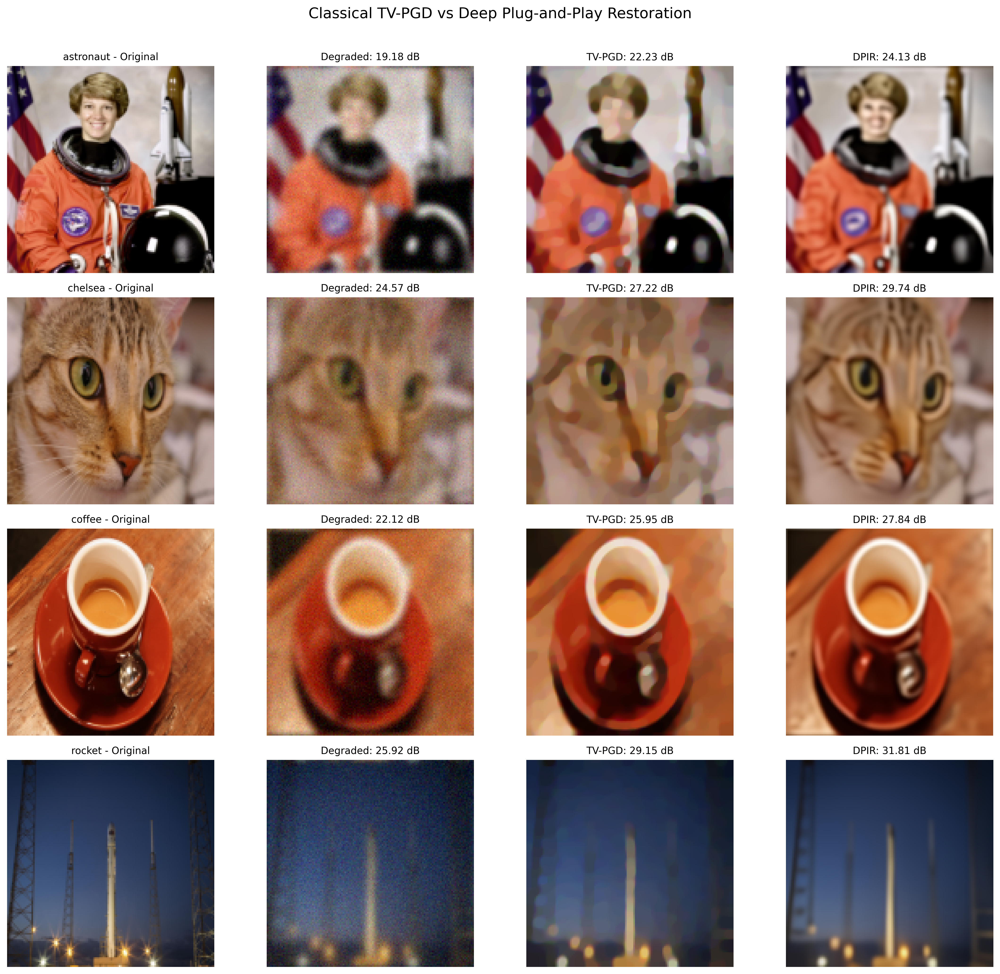
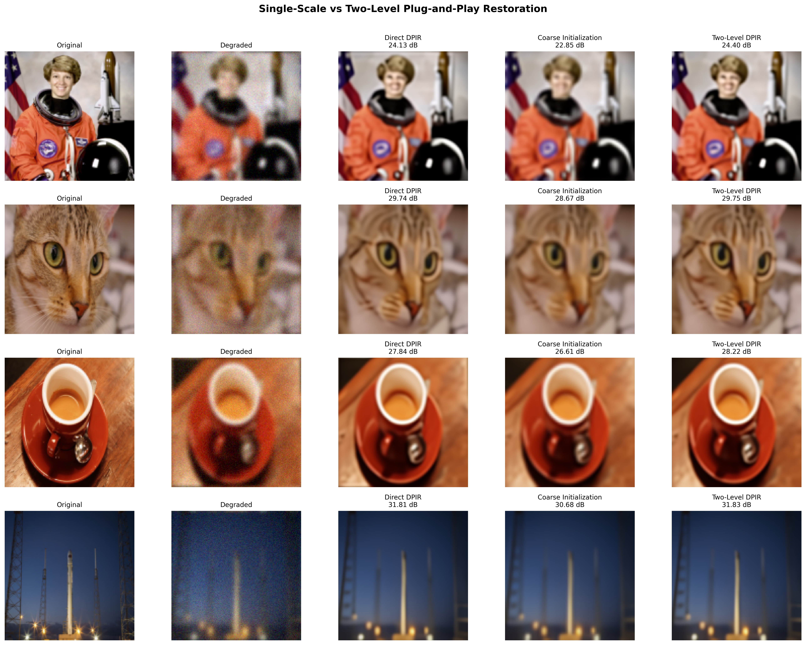
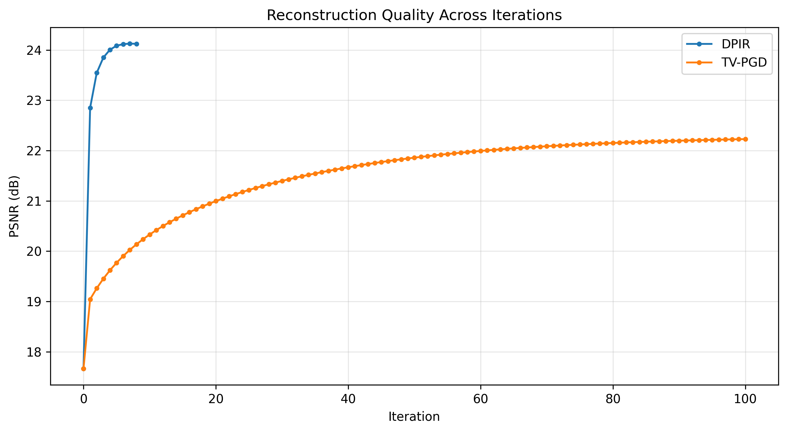
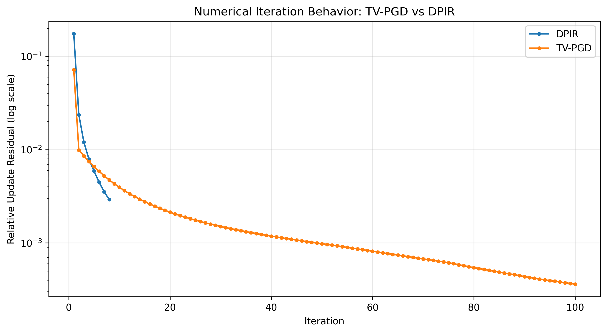
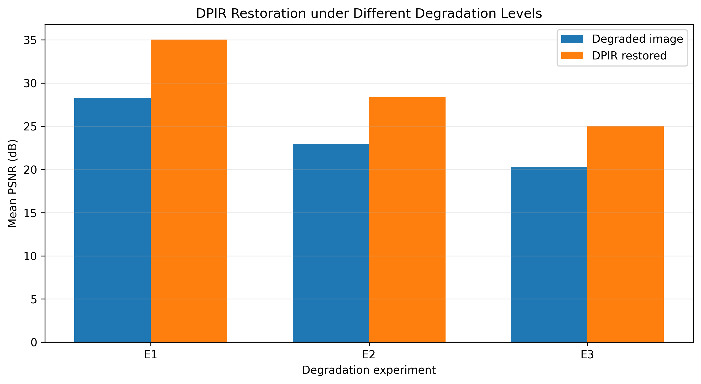
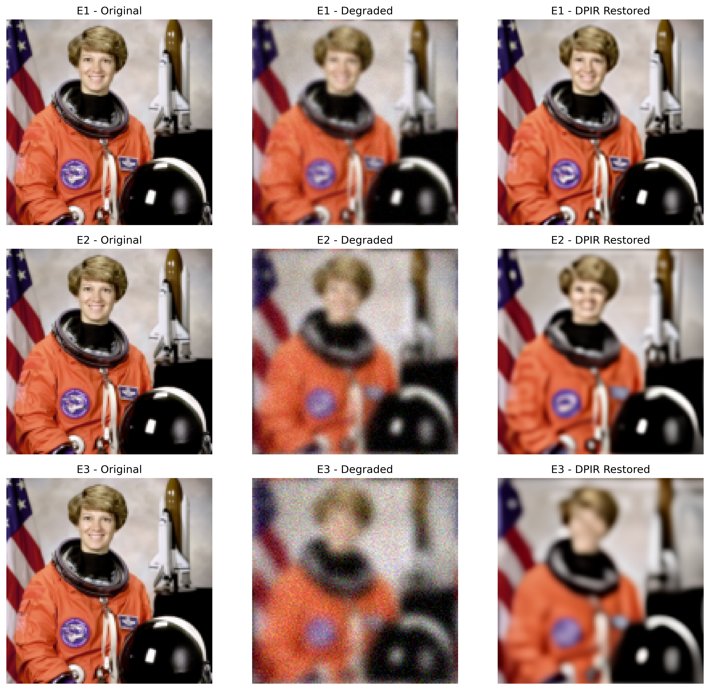

<div align="center">

# Two-Level Coarse-to-Fine Initialization for Plug-and-Play Image Restoration: A Reproducible DeepInverse Benchmark

[](https://python.org)
[](https://pytorch.org)
[](https://deepinv.github.io/deepinv/)
[-76B900?style=flat&logo=nvidia&logoColor=white)](#10-reproducibility-instructions)
[](DeepInverse_PnP_Research_Report.pdf)
[](scripts/validate_results.py)
[](LICENSE)

[**Read 6-Page Research Report (PDF)**](DeepInverse_PnP_Research_Report.pdf) • [**Launch in Google Colab**](https://colab.research.google.com/github/Hasnain006-nain/deepinverse-pnp-image-restoration/blob/main/notebooks/DeepInverse_PnP_Image_Restoration.ipynb) • [**Raw Numerical CSV Traces**](results/) • [**Automated Validation**](scripts/validate_results.py)

<br/>



</div>

---

## 1. Research Title and Concise Overview

This repository provides a controlled, open-science computational imaging benchmark investigating whether an exploratory **two-level coarse-to-fine initialization strategy** improves Plug-and-Play (PnP) image restoration when paired with a deep residual denoiser prior.

Using the open-source **[DeepInverse](https://deepinv.github.io/deepinv/)** framework [1] and pretrained **DRUNet** denoiser weights [2], we evaluated 60 reconstruction runs across 20 matched image-seed observations (four canonical test images: `astronaut`, `chelsea`, `coffee`, `rocket`, each evaluated under five pseudo-random noise realizations) degraded by synthetic Gaussian blur ($\sigma_b = 2.0$) and additive white Gaussian noise ($\sigma_n = 0.03$).

> **Core Empirical Finding:** Coarse PnP initialization yielded a higher reconstruction PSNR across **20 out of 20 matched pairs (+0.1820 dB average gain)** compared to standard direct DPIR, while requiring **38.7% more GPU execution time**. A controlled ablation reveals that **~65% of this benefit (+0.1183 dB)** is produced solely by low-pass smoothing during resolution cycling, with active coarse denoising providing the remaining +0.0637 dB. Benefits are concentrated on smooth surfaces (+0.3972 dB on `coffee`) and negligible on dense textures (+0.0149 dB on `chelsea`).

---

## 2. Research Problem and Motivation

Linear inverse problems in computational imaging require recovering an underlying uncorrupted scene $x \in \mathbb{R}^n$ from degraded measurements:

$$y = A x + n$$

where $A$ is a linear forward operator (e.g., a blur point spread function) and $n \sim \mathcal{N}(0, \sigma^2 I)$ is additive measurement noise. Because $A$ is ill-conditioned and attenuates high spatial frequencies, direct pseudoinverse solutions severely amplify noise, requiring mathematical or learned image priors for regularization.

Plug-and-Play (PnP) methods [3, 4, 5] replace analytical regularizers (such as Total Variation [7]) with high-capacity deep denoisers within variable-splitting schemes such as Half-Quadratic Splitting (HQS) [9] or ADMM. Zhang et al. [2] developed DPIR, integrating a Deep Residual U-Net (DRUNet) into HQS to produce state-of-the-art restorations across multiple inverse problems.

Standard DPIR initializes its fine-scale solver directly from the degraded measurement: $x_0 = y$. Drawing inspiration from multigrid principles in scientific numerical computing [10], we investigate whether a coarse-scale warm-start provides a better-conditioned starting estimate that improves final restoration fidelity on small images.

---

## 3. Research Questions

This benchmark systematically addresses four empirical questions:

1. **Restoration Quality:** Does initializing fine-scale DPIR from an approximate coarse-level restoration improve objective PSNR and SSIM over standard direct initialization ($x_0 = y$)?
2. **Mechanism Attribution:** How much of any observed gain is attributable to active coarse deep denoising versus the passive low-pass filtering inherent in resolution downsampling and upsampling?
3. **Frequency Sensitivity:** How do restoration gains correlate with image spatial frequency distributions (broad smooth gradients vs. dense high-frequency textures)?
4. **Computational Trade-Off:** Does the quality gain justify the additional runtime (+38.7%) incurred by executing a coarse restoration stage?

---

## 4. Experimental Methodology

- **Benchmark Cohort:** Four standard images from `scikit-image` (`astronaut`, `chelsea`, `coffee`, `rocket`), standardized to $128 \times 128$ RGB pixels and normalized to $[0, 1]$.
- **Degradation Model:** $7 \times 7$ Gaussian blur kernel with standard deviation $\sigma_b = 2.0$, followed by additive white Gaussian noise with standard deviation $\sigma_n = 0.03$.
- **Replicate Structure:** Five pseudo-random noise realizations (seeds 2026, 2126, 2226, 2326, 2426 + image offset) applied to each image, yielding **20 matched image-seed observations**. Each observation $y$ was passed identically to all evaluated pipelines. Repeated seeds on the same four images are correlated at the image level and do not constitute independent image samples.
- **Optimization Architecture:** Half-Quadratic Splitting (HQS) with an 8-iteration schedule using fixed pretrained DRUNet weights (no model retraining performed).
- **Evaluation Metrics:** Clipped $[0, 1]$ RGB Peak Signal-to-Noise Ratio (PSNR) and Structural Similarity Index (SSIM) [8] computed against clean ground truth.
- **Timing Protocol:** Wall-clock inference recorded with explicit CUDA synchronization (`torch.cuda.synchronize()`) on an NVIDIA Tesla T4 GPU (16 GB VRAM).

---

## 5. Method Comparison

All pipelines utilize the identical pretrained DRUNet denoiser checkpoint and 8-iteration HQS schedule. The only variable across conditions is the initial state estimate $x_0$:

| Pipeline ID | Strategy Name | Operational Description | Avg. Runtime (T4) | Relative Compute |
|:---:|:---|:---|:---:|:---:|
| **1** | **Direct DPIR** *(Baseline)* | Standard optimization initialized directly from the noisy observation: $x_0 = y$. | **0.2719 s** | $1.00\times$ (baseline) |
| **2** | **Observation Init** *(Control)* | Observation $y$ is downsampled via $2\times 2$ average pooling to $64\times 64$ and prolonged back to $128\times 128$ via PyTorch **bilinear interpolation** (`align_corners=False`) without coarse denoising, isolating resolution-cycling smoothing. | **0.2735 s** | $+0.6\%$ ($1.01\times$) |
| **3** | **Coarse PnP Init** *(Proposed)* | Solve an approximate coarse forward model ($64\times 64$, blur $\sigma_b = 1.0$, noise $\sigma_n = 0.015$) with 8-iteration coarse DPIR. Prolong the coarse output via **bilinear interpolation** to warm-start fine-scale $128\times 128$ DPIR. | **0.3772 s** | **$+38.7\%$ ($1.39\times$)** |

*Note on Coarse Operator:* The coarse blur model was approximated by parameterizing a Gaussian blur kernel with $\sigma_b = 1.0$ and noise $\sigma_n = 0.015$ on $64\times 64$, rather than deriving a mathematically exact Galerkin restriction operator $A_c = R A P$ [10].

---

## 6. Main Quantitative Results

### Method-Level Aggregates (20 Matched Observations, 60 Total Runs)

| Pipeline Strategy | Mean PSNR (dB) | Mean SSIM | Mean Runtime | Relative Cost |
|:---|:---:|:---:|:---:|:---:|
| Direct DPIR *(Baseline)* | 28.4112 dB | 0.8588 | 0.2719 s | $1.00\times$ |
| Observation Init *(Control)* | 28.5295 dB | 0.8603 | 0.2735 s | $1.01\times$ (+0.6%) |
| **Coarse PnP Init *(Proposed)*** | **28.5932 dB** | **0.8622** | **0.3772 s** | **$1.39\times$ (+38.7%)** |

### Paired Differences Analysis (Identical Degradation Instances)

Evaluating paired differences ($\Delta\text{PSNR} = \text{PSNR}_{\text{method A}} - \text{PSNR}_{\text{method B}}$) on identical degraded inputs isolates algorithmic differences from noise sample variance:

| Paired Comparison | Mean $\Delta$PSNR | Std. Dev. | Positive Pairs / Total | Empirical Win Rate |
|:---|:---:|:---:|:---:|:---:|
| **Coarse PnP vs. Direct DPIR** | **+0.1820 dB** | 0.1714 dB | **20 / 20** | **100.0%** |
| **Observation Init vs. Direct DPIR** | **+0.1183 dB** | 0.1222 dB | **18 / 20** | **90.0%** |
| **Coarse PnP vs. Observation Init** | **+0.0637 dB** | 0.0585 dB | **20 / 20** | **100.0%** |

*Observation Init Details:* Observation initialization was positive in 18 of 20 pairs, with minor negative differences on Chelsea seed 2227 (-0.0008 dB) and Rocket seed 2029 (-0.0018 dB).

---

## 7. Initialization Ablation Analysis

The magnitude of improvement correlates directly with the spatial frequency distribution of the benchmark image:

| Test Image | Dominant Content Characteristics | Coarse vs. Direct | Coarse vs. Obs Init | Obs Init vs. Direct |
|:---|:---|:---:|:---:|:---:|
| **Coffee** | Broad smooth gradients, uniform ceramic cup surface | **+0.3972 dB** | +0.1118 dB | +0.2854 dB |
| **Astronaut** | Mixed structural contours, portrait details | **+0.2868 dB** | +0.1120 dB | +0.1748 dB |
| **Rocket** | Sharp high-contrast boundary edges | **+0.0289 dB** | +0.0235 dB | +0.0054 dB |
| **Chelsea** | High-frequency fur texture, dense whiskers | **+0.0149 dB** | +0.0073 dB | +0.0076 dB |

<div align="center">

<p><i>Figure 2: Mean paired PSNR differences (gain in dB relative to Direct DPIR) across the four benchmark images for Observation Initialization and Coarse PnP Initialization (averaged over five noise realizations per image).</i></p>
</div>

> **Frequency Mechanism Hypothesis:** Spatial downsampling acts as an anisotropic low-pass filter. For images dominated by low-to-medium frequencies (`coffee`, `astronaut`), resolution cycling suppresses observation noise and accelerates gradient recovery. For texture-dense images (`chelsea`, `rocket`), $64\times 64$ downsampling removes the critical spatial frequencies required to reconstruct fine details, yielding minimal net gain.

---

## 8. Visual Reconstruction Examples

### Forward Degradation Model
<div align="center">

<p><i>Figure 1: Clean reference image (128×128) and synthetically degraded observation under Gaussian blur (&sigma;<sub>b</sub> = 2.0) and additive Gaussian noise (&sigma;<sub>n</sub> = 0.03).</i></p>
</div>

### Classical TV-PGD vs. Learned DRUNet DPIR
<div align="center">

<p><i>Figure 3: Clean ground truth, degraded observation, Total Variation (TV-PGD) reconstruction, and learned DRUNet DPIR output.</i></p>
</div>

| Benchmark Image | Degraded Input | Classical TV-PGD [7] | Learned DRUNet DPIR [2] | PSNR Gain | TV Runtime | DPIR Runtime |
|:---|:---:|:---:|:---:|:---:|:---:|:---:|
| **Astronaut** | 19.18 dB | 22.23 dB | **24.13 dB** | **+1.90 dB** | 2.64 s | **0.37 s** *(7.1× faster)* |
| **Chelsea** | 24.57 dB | 27.22 dB | **29.74 dB** | **+2.52 dB** | 2.66 s | **0.35 s** *(7.6× faster)* |
| **Coffee** | 22.12 dB | 25.95 dB | **27.84 dB** | **+1.89 dB** | 2.35 s | **0.37 s** *(6.4× faster)* |
| **Rocket** | 25.92 dB | 29.15 dB | **31.81 dB** | **+2.66 dB** | 2.61 s | **0.36 s** *(7.3× faster)* |

### Stage-by-Stage Visual Progression (Two-Level Pipeline)
<div align="center">

<p><i>Figure 4: Progression through the two-level pipeline: clean reference, degraded observation, direct DPIR, coarse 64×64 restoration, and two-level DPIR output using bilinear prolongation.</i></p>
</div>

---

## 9. Convergence and Robustness Analysis

### Iteration-Level Convergence Behavior
<div align="center">


<p><i>Figure 5: Left: PSNR progression across iterations for TV-PGD (50 steps) and DPIR (8 steps). Right: Logarithmic decay of relative iterate residual ||x<sup>(k)</sup> - x<sup>(k-1)</sup>|| / ||x<sup>(k)</sup>|| demonstrating numerical stabilization within 5 iterations for DPIR. (Note: Empirical residual decay does not constitute a formal mathematical fixed-point convergence proof).</i></p>
</div>

### Robustness Under Coupled Blur and Noise Degradation
<div align="center">


<p><i>Figure 6: Robustness under coupled degradation regimes (E1: &sigma;<sub>b</sub>=1.0, &sigma;<sub>n</sub>=0.01; E2: &sigma;<sub>b</sub>=2.0, &sigma;<sub>n</sub>=0.03; E3: &sigma;<sub>b</sub>=3.0, &sigma;<sub>n</sub>=0.05). Left: Mean PSNR before and after DPIR restoration. Right: Astronaut visual reconstructions across E1, E2, and E3. Note: Blur and noise were scaled simultaneously, so these experiments evaluate combined degradation resilience rather than isolating blur or noise independently.</i></p>
</div>

---

## 10. Reproducibility Instructions

### Option A: Automated Results Validation (Zero-Dependency, Instant)

Validate the entire 60-trial experimental record against documented aggregates without downloading weights or requiring a GPU:

```bash
# Clone the repository
git clone https://github.com/Hasnain006-nain/deepinverse-pnp-image-restoration.git
cd deepinverse-pnp-image-restoration

# Run automated validation (uses standard library Python)
python scripts/validate_results.py
```

### Option B: Run in Google Colab (Full Experimental Execution)

[](https://colab.research.google.com/github/Hasnain006-nain/deepinverse-pnp-image-restoration/blob/main/notebooks/DeepInverse_PnP_Image_Restoration.ipynb)

1. Open the notebook in Google Colab using the badge above.
2. Select **Runtime → Change runtime type → T4 GPU**.
3. Execute cells sequentially to reproduce all 60 restoration trials and re-export CSV traces.

### Option C: Local Environment Setup & PDF Report Compilation

```bash
# Set up virtual environment
python -m venv venv
# Linux / macOS:
source venv/bin/activate
# Windows PowerShell:
.\venv\Scripts\Activate.ps1

# Install dependencies
pip install -r requirements.txt

# Recompile publication-grade 6-page research report PDF
python scripts/generate_pdf_report.py
```

### Documented Benchmark Environment

| Component | Specification | Verified Version |
|:---|:---|:---|
| **Python Runtime** | CPython standard distribution | `3.13.16` |
| **Deep Learning Framework** | PyTorch with CUDA runtime | `2.11.0+cu130` |
| **Computational Imaging Package** | DeepInverse core library [1] | `0.5.0` |
| **Scientific Computing** | NumPy / SciPy | `2.1.3` / `1.14.1` |
| **Visualization & Processing** | Matplotlib / scikit-image | `3.10.0` / `0.25.2` |
| **Technical Report Compiler** | ReportLab PDF engine | `5.1.0` |
| **Hardware Platform** | NVIDIA Tesla T4 GPU | 16 GB GDDR6 VRAM |

File integrity is cryptographically validated using SHA-256 hashes recorded in [`SHA256SUMS.txt`](SHA256SUMS.txt).

---

## 11. Repository Organization

```
deepinverse-pnp-image-restoration/
├── .github/
│   └── workflows/
│       └── validate.yml                 # Automated CI results validation workflow
├── README.md                            # Comprehensive, audited research documentation
├── DeepInverse_PnP_Research_Report.pdf  # Publication-grade 6-page research report PDF
├── RESEARCH_SUMMARY.md                  # Concise numerical audit summary
├── LICENSE                              # MIT License
├── requirements.txt                     # Pinned package dependencies
├── environment.json                     # Environment configuration record
├── SHA256SUMS.txt                       # Cryptographic SHA-256 file hashes
│
├── notebooks/
│   └── DeepInverse_PnP_Image_Restoration.ipynb # Full executable benchmark notebook
│
├── results/                             # Complete raw CSV execution traces (13 files)
│   ├── step10_all_experiments.csv       # All 60 individual trial metrics
│   ├── step10_paired_comparison.csv     # Paired difference traces
│   ├── step11_method_summary.csv        # Aggregate metrics per pipeline
│   ├── step11_image_summary.csv         # Aggregate metrics per image
│   ├── step6_robustness_full_results.csv# Robustness trial metrics (E1-E3)
│   ├── step6_robustness_summary.csv     # Robustness condition summary
│   ├── step7_tv_vs_dpir_results.csv     # TV-PGD vs DPIR benchmark metrics
│   └── step8_convergence_metrics.csv    # Iteration-level convergence traces
│
├── figures/                             # Publication-quality research figures
│   ├── deepinverse_restoration_comparison.png
│   ├── step2_degradation.png
│   ├── step6_psnr_robustness.png
│   ├── step6_visual_comparison.png
│   ├── step7_method_comparison.png
│   ├── step8_convergence_residual.png
│   ├── step8_psnr_vs_iterations.png
│   ├── step9_multilevel_comparison.png
│   └── step10_initialization_ablation.png
│
├── docs/
│   └── DeepInverse_PnP_Research_Report.pdf # Mirrored 6-page report PDF
│
└── scripts/
    ├── generate_pdf_report.py           # ReportLab 6-page PDF compiler script
    └── validate_results.py              # Automated CSV results validation script
```

---

## 12. Limitations & Scoping Statement

1. **Sample Cohort:** The benchmark evaluates four standard images over five noise seeds (20 matched observations). Replicates on the same image are correlated; sixty runs across four images do not constitute sixty statistically independent image samples. Generalization across natural image populations requires broader multi-dataset evaluation.
2. **Heuristic Coarse Forward Operator:** The $64\times 64$ coarse blur model was approximated by parameterizing a Gaussian blur kernel with $\sigma_b = 1.0$ and noise $\sigma_n = 0.015$, rather than deriving a mathematically exact Galerkin restriction operator $A_c = R A P$ [10].
3. **Coupled Robustness Scope:** Experiments E1–E3 scaled blur and noise parameters simultaneously ($\sigma_b \in \{1.0, 2.0, 3.0\}, \sigma_n \in \{0.01, 0.03, 0.05\}$). These tests evaluate combined degradation resilience and do not isolate blur from noise.
4. **Model Scoping Declaration:** This project benchmarks classical and deep denoiser Plug-and-Play restoration (DRUNet-DPIR). **No generative diffusion model or flow-matching algorithm was implemented or trained.**
5. **Execution Ledger:** All timing data reflects CUDA-synchronized execution on a single cloud NVIDIA Tesla T4 GPU session.

---

## 13. Academic References

All 12 citations are primary, peer-reviewed publications verified against official DOI and indexing records, corresponding directly to Section 14 of the research report:

1. **J. Tachella, M. Terris, S. Hurault, A. Wang, et al.**, *"DeepInverse: A Python package for solving imaging inverse problems with deep learning,"* *Journal of Open Source Software (JOSS)*, vol. 10, no. 115, p. 8923, 2025.  
   DOI: [`10.21105/joss.08923`](https://doi.org/10.21105/joss.08923) • arXiv: [`2505.20160`](https://arxiv.org/abs/2505.20160)

2. **K. Zhang, Y. Li, W. Zuo, L. Zhang, L. Van Gool, and R. Timofte**, *"Plug-and-Play Image Restoration with Deep Denoiser Prior,"* *IEEE Transactions on Pattern Analysis and Machine Intelligence (TPAMI)*, vol. 44, no. 10, pp. 6360–6376, Oct. 2022.  
   DOI: [`10.1109/TPAMI.2021.3088914`](https://doi.org/10.1109/TPAMI.2021.3088914)

3. **S. V. Venkatakrishnan, C. A. Bouman, and B. Wohlberg**, *"Plug-and-Play Priors for Model Based Reconstruction,"* in *IEEE Global Conference on Signal and Information Processing (GlobalSIP)*, pp. 945–948, Dec. 2013.  
   DOI: [`10.1109/GlobalSIP.2013.6737048`](https://doi.org/10.1109/GlobalSIP.2013.6737048)

4. **S. H. Chan, X. Wang, and O. A. Elgendy**, *"Plug-and-Play ADMM for Image Restoration: Fixed-Point Convergence and Applications,"* *IEEE Transactions on Computational Imaging (TCI)*, vol. 3, no. 1, pp. 84–98, Mar. 2017.  
   DOI: [`10.1109/TCI.2016.2629286`](https://doi.org/10.1109/TCI.2016.2629286)

5. **E. K. Ryu, J. Liu, S. Wang, X. Chen, Z. Wang, and W. Yin**, *"Plug-and-Play Methods Provably Converge with Properly Trained Denoisers,"* in *International Conference on Machine Learning (ICML)*, PMLR, vol. 97, pp. 5546–5557, Jun. 2019.  
   PMLR: [`v97/ryu19a.html`](https://proceedings.mlr.press/v97/ryu19a.html) • arXiv: [`1905.05406`](https://arxiv.org/abs/1905.05406)

6. **S. Hurault, A. Leclaire, and N. Papadakis**, *"Proximal Denoiser for Convergent Plug-and-Play,"* in *International Conference on Machine Learning (ICML)*, PMLR, vol. 162, pp. 9484–9504, Jul. 2022.  
   PMLR: [`v162/hurault22a.html`](https://proceedings.mlr.press/v162/hurault22a.html) • arXiv: [`2111.08058`](https://arxiv.org/abs/2111.08058)

7. **L. I. Rudin, S. Osher, and E. Fatemi**, *"Nonlinear total variation based noise removal algorithms,"* *Physica D: Nonlinear Phenomena*, vol. 60, no. 1–4, pp. 259–268, Nov. 1992.  
   DOI: [`10.1016/0167-2789(92)90242-F`](https://doi.org/10.1016/0167-2789(92)90242-F)

8. **Z. Wang, A. C. Bovik, H. R. Sheikh, and E. P. Simoncelli**, *"Image quality assessment: From error visibility to structural similarity,"* *IEEE Transactions on Image Processing (TIP)*, vol. 13, no. 4, pp. 600–612, Apr. 2004.  
   DOI: [`10.1109/TIP.2003.819861`](https://doi.org/10.1109/TIP.2003.819861)

9. **D. Geman and C. Yang**, *"Nonlinear image recovery with half-quadratic regularization,"* *IEEE Transactions on Image Processing (TIP)*, vol. 4, no. 7, pp. 932–946, Jul. 1995.  
   DOI: [`10.1109/83.392335`](https://doi.org/10.1109/83.392335)

10. **W. L. Briggs, V. E. Henson, and S. F. McCormick**, *A Multigrid Tutorial*, 2nd ed. Philadelphia, PA: Society for Industrial and Applied Mathematics (SIAM), 2000.  
    DOI: [`10.1137/1.9780898719505`](https://doi.org/10.1137/1.9780898719505)

11. **S. Martin, A. Gagneux, P. Hagemann, and G. Steidl**, *"PnP-Flow: Plug-and-Play Image Restoration with Flow Matching,"* in *International Conference on Learning Representations (ICLR)*, 2025.  
    OpenReview: [`V2c2YxK0eG`](https://openreview.net/forum?id=V2c2YxK0eG) • arXiv: [`2410.21200`](https://arxiv.org/abs/2410.21200)

12. **D. Ulyanov, A. Vedaldi, and V. Lempitsky**, *"Deep Image Prior,"* in *IEEE/CVF Conference on Computer Vision and Pattern Recognition (CVPR)*, pp. 9446–9454, Jun. 2018.  
    DOI: [`10.1109/CVPR.2018.00984`](https://doi.org/10.1109/CVPR.2018.00984) • arXiv: [`1711.10925`](https://arxiv.org/abs/1711.10925)

---

## 👤 Author

**Hasnain Haider**  
GitHub: [@Hasnain006-nain](https://github.com/Hasnain006-nain)  
Project Repository: [deepinverse-pnp-image-restoration](https://github.com/Hasnain006-nain/deepinverse-pnp-image-restoration)

---

## 📜 License

This research code, benchmark datasets, and documentation are licensed under the **[MIT License](LICENSE)**.
